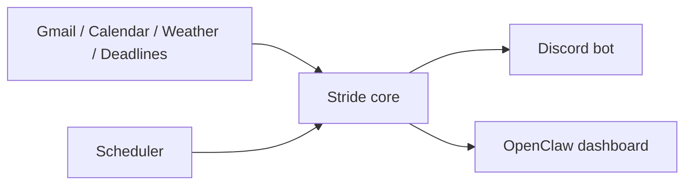

# 🏃 Stride

**A hybrid AI student assistant that brings email, schedules, weather, and academic tasks into one place through Discord and an OpenClaw dashboard.**


<!-- TODO: replace with a real screenshot or GIF of a Discord briefing -->


📺 **Demo video:** _add your link here_

## The problem

Students juggle deadlines in one place, emails in another, classes in a calendar, and
group chats everywhere else. Important things get missed, not because students don't
care, but because the information is scattered.

## The solution

Stride gathers it all and delivers what matters, when it matters, right where students
already spend their time: Discord.

## Features

- **Daily briefings and evening recaps** summarizing deadlines, emails, weather, and upcoming events.
- **Meeting reminders** delivered to Discord, with checks every five minutes and duplicate prevention.
- **Email and calendar assistance** to summarize messages, identify preparation items, and detect scheduling conflicts.
- **On-demand commands:** `!briefing` and `!conflicts`.

## Hybrid by design

Stride uses plain, testable code for anything that must be exact, and AI only where language
understanding adds value.

| Task | Approach |
|------|----------|
| Conflict detection, reminder timing, dedupe | Deterministic code |
| Weather and schedule formatting | Deterministic code |
| Email summaries and prep suggestions | AI model |

This keeps the frequent 5-minute checks fast, free, and predictable. See
[docs/architecture.md](docs/architecture.md) for the full diagram.

## Architecture



## Quick start

```bash
# 1. Clone
git clone https://github.com/<your-username>/stride.git
cd stride

# 2. Create a virtual environment and install
python -m venv .venv
source .venv/bin/activate        # Windows: .venv\Scripts\activate
pip install -e ".[dev]"

# 3. Configure
cp .env.example .env             # then fill in DISCORD_TOKEN and DISCORD_CHANNEL_ID

# 4. Run
python -m stride
```

### Creating the Discord bot
1. Go to the [Discord Developer Portal](https://discord.com/developers/applications) and create an application.
2. Under **Bot**, copy the token into `.env` and enable **Message Content Intent**.
3. Invite the bot to your server with the `bot` scope and permission to send messages.
4. Copy your channel's ID (enable Developer Mode in Discord) into `.env`.

## Run the tests

```bash
pytest
```

Tests cover conflict detection, reminder deduplication (including persistence across restarts), and briefing generation.

## Project structure

```
src/stride/
├── bot.py            Discord bot and scheduled jobs
├── briefing.py       Morning briefing / evening recap / reminder text
├── conflicts.py      Overlap detection
├── dedupe.py         Duplicate-reminder prevention (persisted)
├── reminders.py      Which reminders are due right now
├── config.py         Environment-based configuration
└── integrations/     Weather (Open-Meteo) and calendar / mail / deadline providers
```

## Current status

- ✅ Discord bot with scheduled briefings, recaps, 5-minute reminder checks
- ✅ Conflict detection and duplicate prevention, with tests
- ✅ Live weather via Open-Meteo
- 🟡 Calendar, email, and deadlines use **demo providers** (same interface as real ones)
- 🟡 AI summarization and OpenClaw dashboard: _update this to match what you've built_

## Privacy

Stride only reads the minimum needed to build briefings. Secrets live in `.env`
(never committed). Only reminder IDs are stored locally to prevent duplicates;
email content is not persisted.

## Roadmap

- [ ] Gmail and Google Calendar integrations (OAuth)
- [ ] AI-generated email summaries and prep checklists
- [ ] Deadline import from LMS (Moodle / Google Classroom)
- [ ] Per-user preferences and multi-user support
- [ ] Dashboard analytics: workload heatmap

## Team

| Name | Role |
|------|------|
| _Your name_ | _e.g. Backend, Discord bot_ |

## License

MIT, see [LICENSE](LICENSE).
