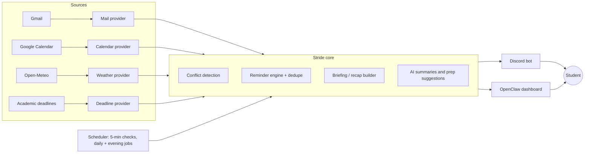

# Architecture

## Hybrid design: AI vs plain logic

| Task | Approach | Why |
|------|----------|-----|
| Conflict detection | Deterministic code | Must be 100% correct, testable |
| Reminder timing + duplicate prevention | Deterministic code | Predictable, no LLM cost per check |
| Weather and schedule formatting | Deterministic code | Fast, free, reliable |
| Email summaries, prep-item extraction | AI model | Needs language understanding |

Cheap, frequent jobs (the 5-minute check) never call a model. The AI layer is
used only where language understanding adds real value.
